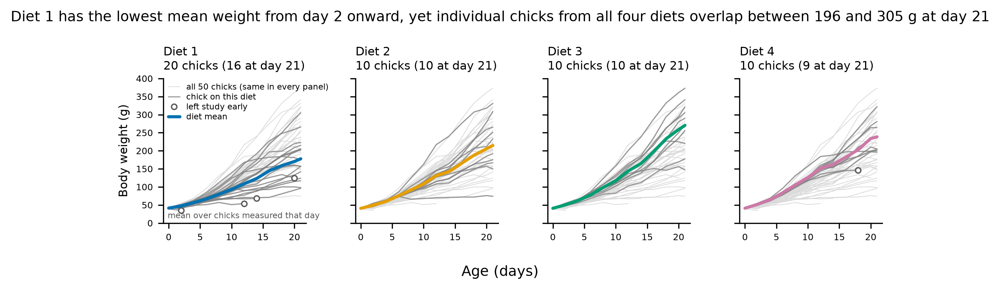
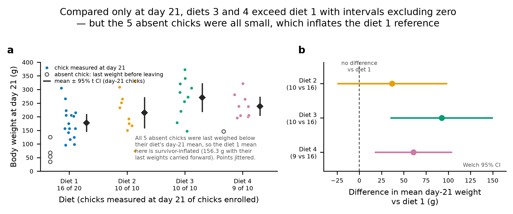

# figure-contract

A scientific-figure rubric, codified twice: once as a **generative skill** that an
agent loads before drawing anything, and once as a **reviewer profile** that
critiques the rendered result. Plus a worked example on R's `ChickWeight`.

The organising idea comes from the lecture this was built for: **a figure is a
contract between its maker and its reader** — *"when I draw it this way, you can
reasonably read it this way."* The reader cannot inspect every analysis decision
while looking at a figure, so the maker owes them inferences that are warranted.
Five promises:

| Promise | What it means |
|---|---|
| **Magnitude** | Twice the bar length really means twice the value. |
| **Meaning** | Every line, color, position and distance has a stated interpretation. |
| **Evidence** | The reader can identify n, the experimental unit, pairing and uncertainty. |
| **Context** | Denominators, exclusions and transformations are visible. |
| **Claim** | The title says only what the data and the design support. |

## Layout

```
skill/SKILL.md              the rules: chart choice from the question, proportional
                            encoding, log and fold-change scales, line semantics,
                            missing vs measured, color matched to variable structure,
                            n / unit / pairing / uncertainty, denominators and
                            transforms, supported titles, panel layout
skill/kernel.py             audit_figure(fig) + helpers; the mechanical half of the rubric
reviewer/FIGURE_REVIEWER.md the review agent's system prompt
make_figures.py             reproduces both figures and audits them before saving
data/chickweight.csv        R datasets::ChickWeight, 578 rows, 50 chicks, 4 diets
figures/                    the two figures, post-review
figure_review.md            the reviewer's report on the pre-review drafts
```

## What the audit checks

`audit_figure(fig)` is the part that does not need judgement: truncated bar
baselines and non-zero bar bottoms, axis labels (satisfied by a figure-level
`supxlabel` or a labeled shared-axis sibling), missing titles, log scales not
disclosed in the axis label, too many *distinguishable* series in one panel, rainbow
colormaps, images without a colorbar, twin axes, and panels that share a y-label but
not y-limits. Self-labeling categorical axes are exempt — an axis title restating
the tick labels is itself an anti-pattern.

Silence from the audit is not a passing grade. n, the experimental unit,
denominators, exclusions and whether the title is true of every row are checked by
hand, or by the reviewer.

## Worked example

Two questions about `ChickWeight`:

1. How do growth trajectories differ across diets, and how consistent are those
   patterns across individual chicks?
2. What changes if we compare only the final measurement?



Mean weight separates by diet from day 2 onward with diet 1 lowest throughout, and
diets 3 and 4 steepest — but individual chicks from all four diets overlap between
196 and 305 g at day 21, and within-diet consistency varies more than the means do
(day-21 CV: diet 4 18%, diet 3 27%, diet 1 33%, diet 2 36%). The full 50-chick
cohort is repeated as a backdrop in every panel so that overlap is visible without a
panel jump; chicks that left the study stop at an open circle rather than having a
line carried across days they were not weighed.



Restricting to day 21 keeps the diet 3 (+92.6 g, Welch 95% CI 35.5 to 149.6) and
diet 4 (+60.8 g, 18.0 to 103.6) contrasts and loses diet 2 (+36.9 g, −24.2 to 98.1)
— at the cost of 11 timepoints, all within-chick information, and 5 animals.

## What the review caught

Both drafts kept all five promises, and the reviewer still found the thing that
mattered. The five chicks that never reach day 21 were last weighed at 125, 68, 54,
35 g (diet 1) and 146 g (diet 4) — every one below its diet's day-21 mean. Diet 1
loses 4 of 20, so its day-21 mean of 177.8 g is survivor-inflated: carry those last
weights forward and it is 156.3 g. The first draft's caveat, *"but 5 of 50 chicks are
absent"*, was honest about the count and silently wrong about the direction — a
reader takes it as grounds to discount the diet 3 and 4 advantage, when the attrition
is shrinking that advantage.

Keeping a promise is not the same as pointing the reader the right way. Figure 2 now
plots each absent chick's last weight as an open circle and states the direction of
the bias. See [figure_review.md](figure_review.md) for the full per-promise report.

## Reproduce

```
pip install numpy pandas scipy matplotlib
python make_figures.py
```

Prints the day-21 summaries and contrasts, writes both PNGs to `figures/`, and exits
non-zero if `audit_figure` reports an unresolved violation.

## Provenance

Rules codified from a graduate data-visualization lecture (the figure-as-contract
framework, its published critique examples and speaker notes). The deck itself is
course material and is not redistributed here. Sources it names: Weissgerber et al.
2015 (PLoS Biol); Cumming et al. 2007 (JCB); Lord et al. 2020 (JCB, experimental
unit); Crameri et al. 2020 (Nat Commun, color); Matejka & Fitzmaurice 2017 (same
stats, different graphs). Two of its notes pages also link a reading as
`cleveland84.pdf` without naming it; that file is Cleveland & McGill's 1984
graphical-perception paper, identified here from the URL rather than cited by the
deck, and it underlies the position-over-length and common-axis rules. `ChickWeight` ships with R
(`datasets`); originally from Crowder & Hand, *Analysis of Repeated Measures* (1990).
